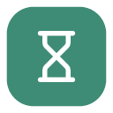
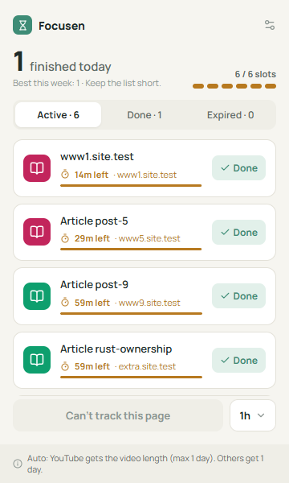
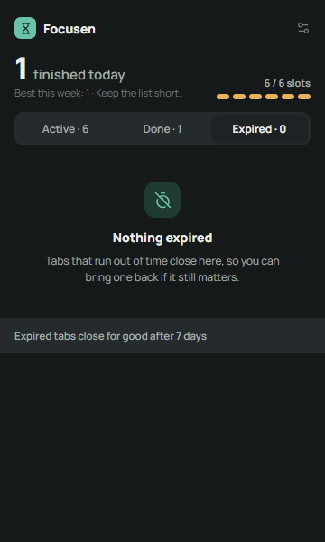
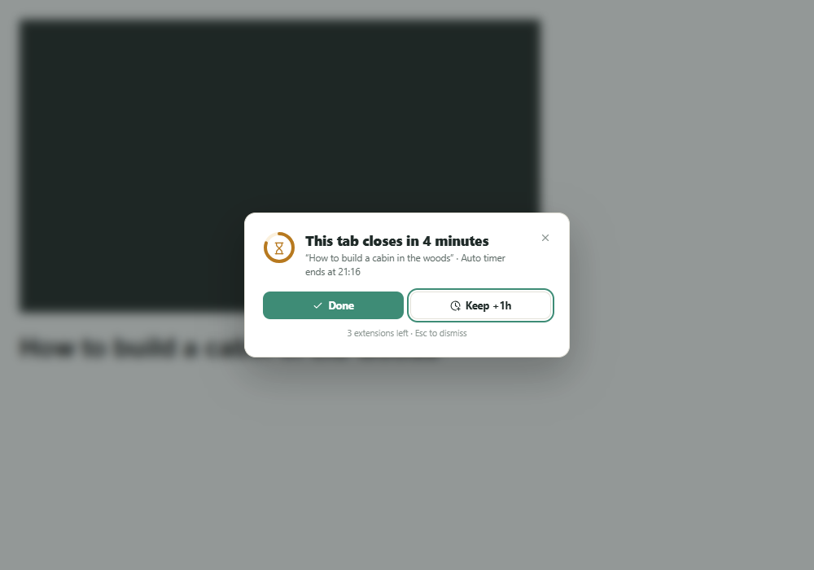

<div align="center">



# Focusen

**Give every tab a deadline. Finish it, or let it close.**

A small browser extension for people with 47 tabs open "to read later."<br />
Chrome · Edge · Firefox · Manifest V3 · no accounts, no tracking

</div>

<p align="center">
  
  &nbsp;
  
</p>

## Why

Open tabs are promises you made to yourself and never kept. Bookmarks are where they go to be forgotten. Focusen takes a different approach: when you open something you mean to get to, give it a timer. When the time is up, you either deal with it or it goes away, and you get exactly one second chance.

It turns out most of those tabs didn't matter. The ones that did, you finish.

## How it works

1. **Track a tab.** Use the popup, the right-click menu, or `Alt+Shift+K`. Choose a timer from 15 minutes to 1 day, or leave it on **Auto**.
2. **Auto does the obvious thing.** A YouTube video gets as long as the video runs (it never closes mid-video). Any other page gets a day.
3. **You get a warning first.** A few minutes before the deadline, a small card appears on the page (or a notification, if the tab is in the background) with **Done** and **Keep +1h**.
4. **Done is a small win.** Done tabs go into a log, with a "finished today" counter and your best day this week.
5. **Expired isn't gone.** Tabs that run out of time wait under **Expired** for 7 days. You can reopen each one once, and a video resumes where you left off.

<p align="center">
  
</p>

### Guard rails

- **Six slots.** A short list is the point. When it's full, Focusen asks you to finish or drop something first.
- **Never closes what you're using.** A tab that's playing audio or is fullscreen gets another warning instead of being closed.
- **Sleep and restarts are safe.** If your laptop slept through a deadline, you get a fresh warning and the tab isn't closed instantly. After a browser restart, tracked tabs are found again by their address.
- **Keep +1h is limited.** You can extend a tab 3 times; the timer can't be pushed back forever.

## Privacy

Everything stays in your browser. Focusen has no servers, no analytics and no accounts. It stores the address, title and timer of the tabs you choose to track, and reads a YouTube video's length from the page you're on. Host access is limited to YouTube; in-page warnings on other sites are opt-in. See [PRIVACY.md](PRIVACY.md).

## Install

Focusen isn't in the extension stores yet. To run it now:

```bash
git clone https://github.com/rifkymol/focusen.git
cd focusen
npm install
npm run build
```

Then open `chrome://extensions` (or `edge://extensions`), turn on **Developer mode**, click **Load unpacked** and select `.output/chrome-mv3`.

For Firefox, run `npm run build:firefox` and load `.output/firefox-mv3/manifest.json` from `about:debugging` → **This Firefox** → **Load Temporary Add-on**.

## Development

Built with [WXT](https://wxt.dev) and TypeScript, with no UI framework; the popup is plain DOM.

```bash
npm run dev            # Chrome with hot reload
npm run dev:firefox    # Firefox with hot reload
npm test               # unit tests for the deadline logic (Vitest)
npm run e2e            # builds, then drives a real Chromium with the extension loaded (Playwright)
npm run compile        # type-check
npm run zip            # store-ready zip (zip:firefox for Firefox)
```

The end-to-end test serves a fake YouTube watch page through Playwright request routing, so it never touches the network. It uses the Playwright Chromium in `%LOCALAPPDATA%\ms-playwright` by default; set `CHROMIUM` to use a different build.

### Where things live

| What | Where |
|---|---|
| Deadline rules, as pure functions (`step(record, settings, now)`) | [`src/lib/deadline.ts`](src/lib/deadline.ts) |
| Storage, the single source of truth, with serialized writes | [`src/lib/store.ts`](src/lib/store.ts) |
| Background worker: alarms, `reconcile()`, re-matching tabs after a restart, badges, notifications | [`src/entrypoints/background.ts`](src/entrypoints/background.ts) |
| YouTube video length (skips ads, handles live streams, Shorts and in-app navigation) | [`src/entrypoints/youtube.content.ts`](src/entrypoints/youtube.content.ts) |
| In-page warning (Shadow DOM, accessible dialog, keyboard friendly) | [`src/entrypoints/overlay.ts`](src/entrypoints/overlay.ts) |
| Popup and settings page | [`src/entrypoints/popup`](src/entrypoints/popup), [`src/entrypoints/options`](src/entrypoints/options) |

### Design notes

- **Storage is the truth; alarms only wake the worker.** MV3 service workers die whenever they like, so nothing important lives in memory. Every wake re-reads storage, matches records to open tabs, and runs `step()` on each one.
- **A missed deadline is a fresh warning, never an instant close.** That covers sleep, a closed browser and a slow alarm.
- **Tab IDs don't survive a restart.** When `storage.session` is empty, it's a new browser session, so every record is matched again by URL, then by title and site. One that can't be found within 2 minutes moves to Expired as "lost," where it can still be reopened.
- **A video's length is a floor, not a schedule.** Pausing or seeking never shortens the timer, and every tab has a hard 24-hour cap from when you started tracking it.

## Contributing

Issues and pull requests are welcome. Good places to start:

- **Translations.** The UI is English-only; it needs `_locales` and i18n.
- **First-run onboarding.** A short "here's how this works" for new installs.
- **Stats.** Finished-vs-expired over time, beyond the weekly line.
- **More video sites.** Vimeo, Twitch VODs and others could get the same length detection as YouTube.
- **Real-world checks.** If YouTube changes its player and video length detection breaks, an issue with the video URL helps a lot.

Before opening a PR, please run `npm run compile`, `npm test` and `npm run e2e`.
